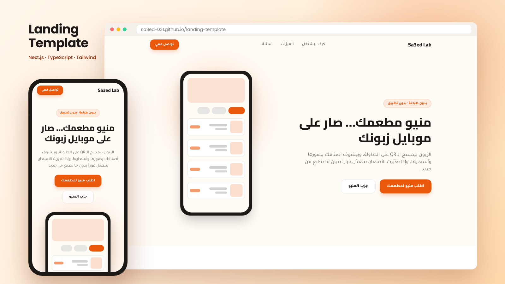

# Menu Landing

A landing page for a **QR digital menu service** for restaurants and cafés, in Arabic (RTL).
Built in a few config files with my reusable [Landing Template](https://github.com/Sa3ed-031/landing-template) (Next.js, TypeScript & Tailwind CSS).

🔗 **Live:** [sa3ed-031.github.io/menu-landing](https://sa3ed-031.github.io/menu-landing/)

---

## 🍽️ What's on the page

- **Hero:** the main promise (no printing, no app) with a call to action on WhatsApp
- **The problem:** why printed menus cost restaurants time and money
- **How it works:** three simple steps, from scanning the QR code to ordering
- **Features:** what the digital menu offers restaurant owners and their customers
- **FAQ:** answers to the most common questions before getting in touch
- **Final call to action:** a direct way to request a menu

## 🧩 How it was built

This page was created from the [Landing Template](https://github.com/Sa3ed-031/landing-template) by changing only two config files:

- `src/config/theme.ts`: a warm orange palette that suits food and hospitality
- `src/config/content.ts`: all the Arabic text, links and section order

The fonts (Cairo & Tajawal, self-hosted) are the template's defaults.

No component was edited, which is the whole point of the template.

## 🛠️ Tech Stack

- [Next.js](https://nextjs.org/) (App Router, Static Export)
- [TypeScript](https://www.typescriptlang.org/)
- [Tailwind CSS](https://tailwindcss.com/)
- [Motion](https://motion.dev/)
- GitHub Actions → GitHub Pages

---

Built by [Saeed Al-Haj Hussein](https://sa3ed-031.github.io) · All rights reserved.
